# Pentest Activity — Burp Suite Extension

`burp-activity` is a Burp Suite extension that **reconstructs penetration testing
activity from the HTTP traffic Burp already captures**. It is fully passive and
runs entirely inside Burp Suite + a local SQLite database — it never sends
additional requests to targets and never contacts any external service.

It reconstructs the activities a tester performed (not the vulnerabilities they
found), so you can ask:

- *What activities did I perform today / on 20 November 2026 / between two
  dates?*
- *How many SQL Injection probes did I run, and on which endpoints/parameters?*
- *Which endpoints and parameters were tested most frequently, and with which
  techniques/payloads?*
- *Show me the raw HTTP request/response behind this grouped activity.*

Detected items describe **testing activity and observed evidence** — they are
**not** confirmed vulnerabilities. Each automatic classification carries a
confidence score and a clear "auto vs manual" source flag, and the UI never
asserts that a vulnerability exists.

---

## Screenshots

| Feature | Light | Dark |
|---------|-------|------|
| **Dashboard** — totals, distribution and daily volume | 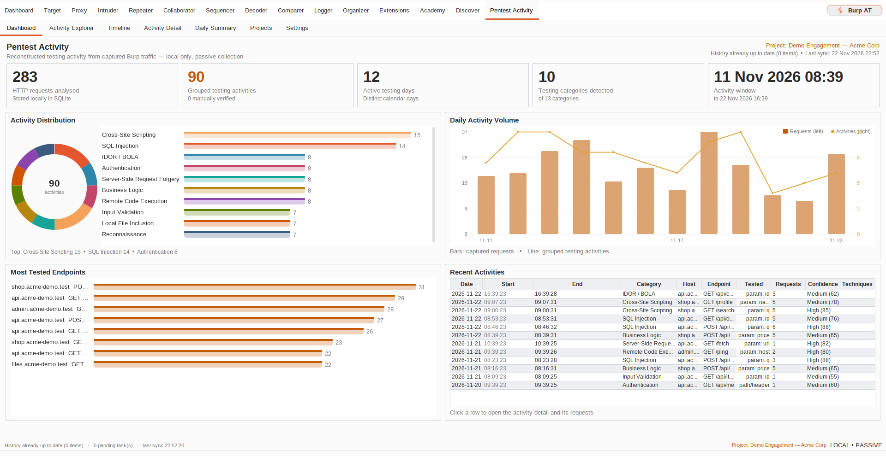 | 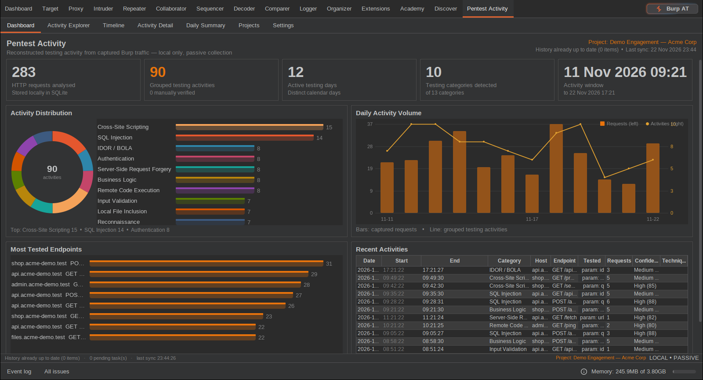 |
| **Activity Explorer** — searchable activities, tested parameter, evidence | 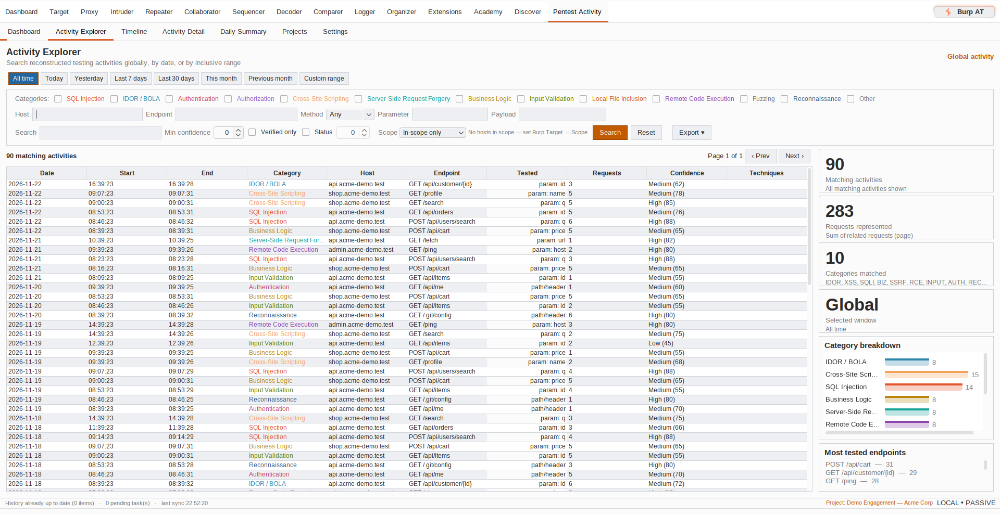 | 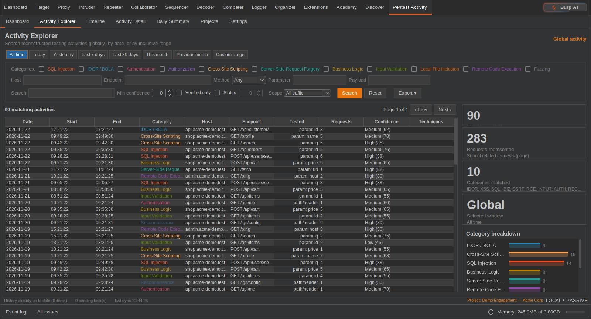 |
| **Activity Detail** — merged requests + evidence, split editors with highlighting | 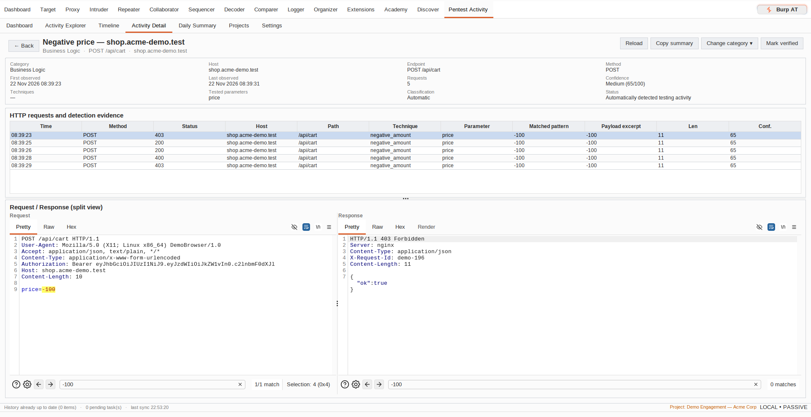 | 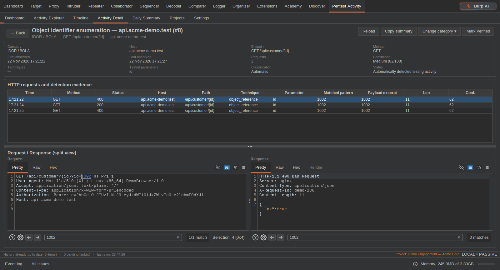 |
| **Timeline** — sessions by day with the daily volume chart | 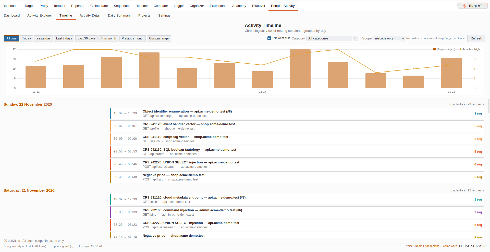 | 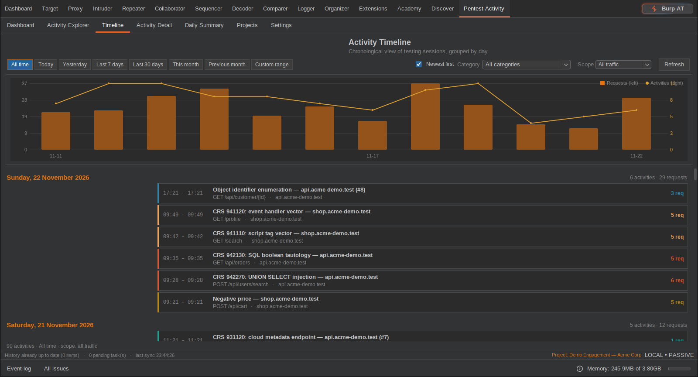 |
| **Daily Summary** — scope-aware report with KPI cards | 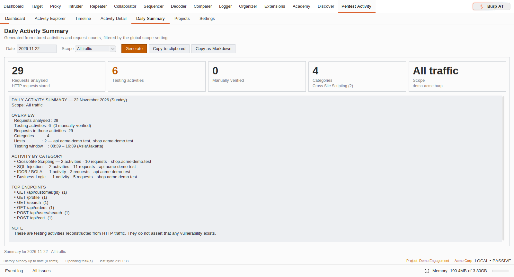 | 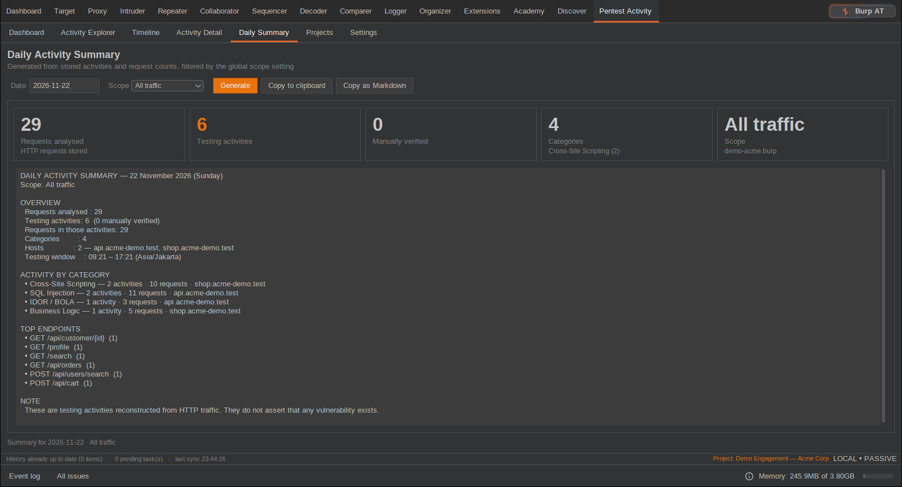 |
| **Projects** — one activity project bound to each Burp project | 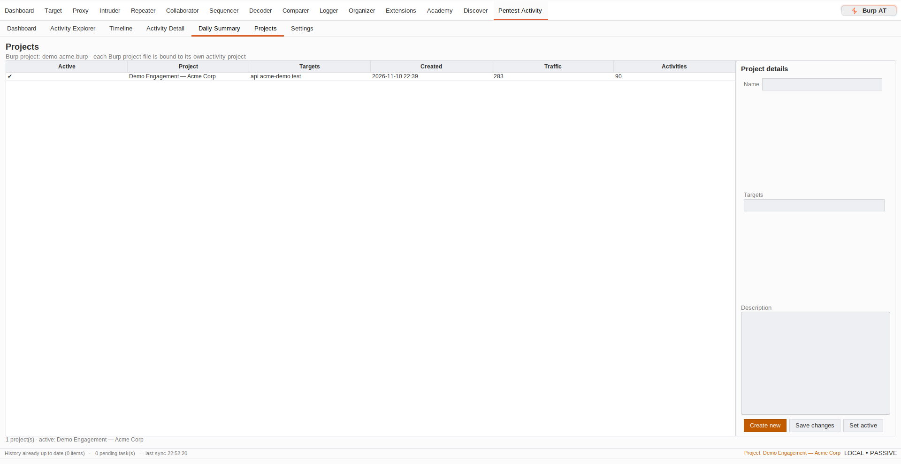 | 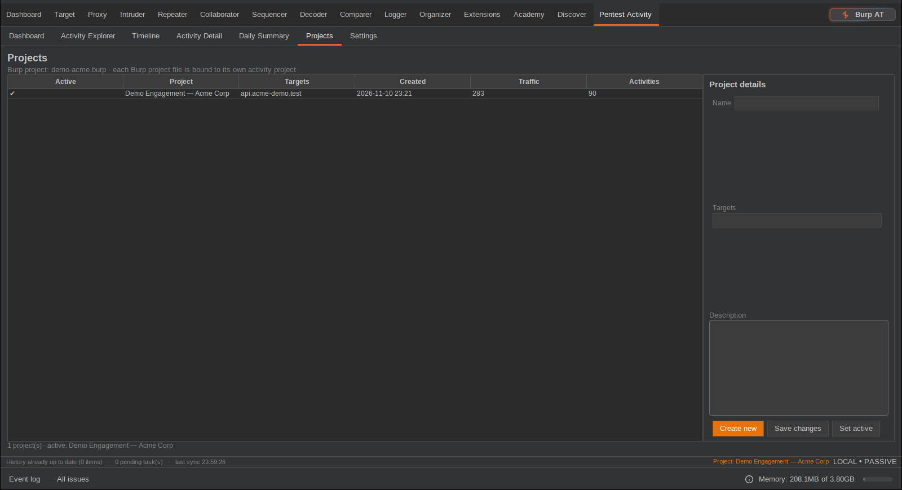 |
| **Settings / About** — storage, detection, theme and author links | 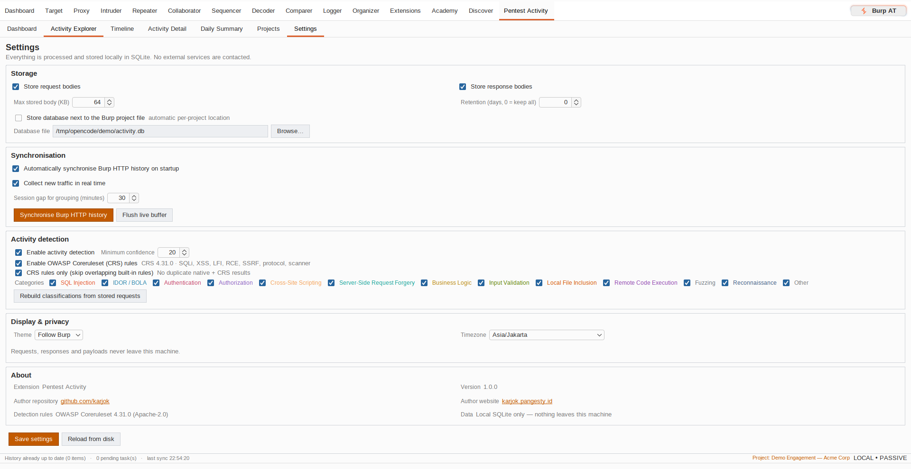 | 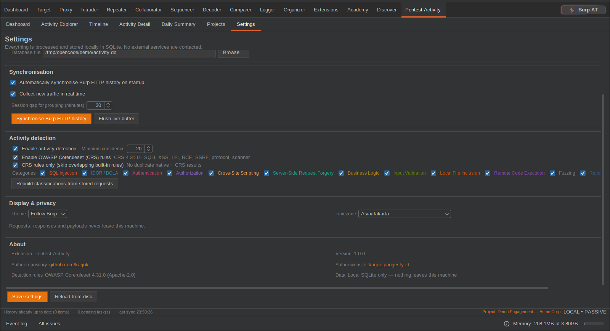 |
| **Table layout** — show/hide columns, pack and reset | 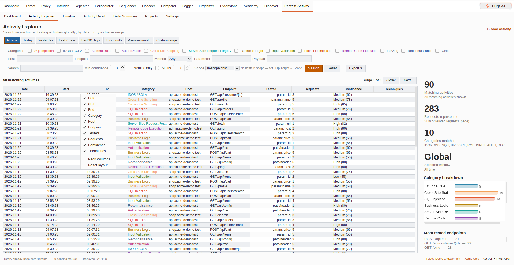 | 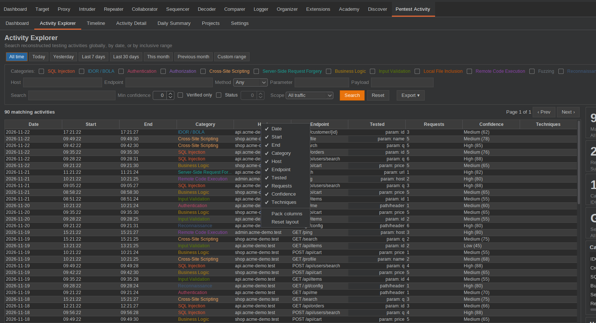 |

---

## Build

| Requirement   | Version                                                    |
|---------------|------------------------------------------------------------|
| JDK           | 17 or newer (built and tested with JDK 17/21/25)           |
| Maven         | 3.8+                                                       |
| Burp Suite    | 2026.x (Montoya API `net.portswigger.burp.extensions:montoya-api:2026.7`, `provided` scope) |
| SQLite driver | `org.xerial:sqlite-jdbc:3.54.1.0` (shaded into the jar)   |

```bash
mvn package          # runs unit/integration tests, then shades the runnable jar
# or, to skip tests:
mvn package -DskipTests
```

The artifact is `target/burp-activity.jar`. Tests run against real SQLite
(`DatabaseTest`) and the pure-Java classifier (`DetectionTest`) and require no
network access.

### Install into Burp Suite
1. Burp → **Extensions** → **Installed** → **Add**.
2. Extension type: **Java**, extension file: `target/burp-activity.jar`.
3. A new top-level **Pentest Activity** tab appears. The first launch creates a
   default project and opens the SQLite database at
   `<user.home>/.burp/pentest-activity/activity.db`. Change the path in the
   **Settings** tab; the change takes effect after reloading the extension.

---

## What it does

| Capability                          | Where                                  |
|-------------------------------------|----------------------------------------|
| Passive collection (no extra requests) | `core/TrafficCollector`                |
| Live capture from Proxy, **Repeater**, Intruder, Scanner and extensions | Proxy response handler + HTTP handler (flushed every 2 s) |
| Burp HTTP history reconciliation (initial + incremental) | `snapshotHistory` + `maxBurpItemId` |
| Original-timestamp preservation (with documented fallback) | `ProxyHttpRequestResponse.time()` |
| Duplicate detection across restarts | `(project_id, ingest_key)` unique index |
| Live/history adoption (no twin rows) | `RequestRepository.adoptLiveRecord`   |
| Rule-based classifier, extensible   | `analyzer/DetectionRuleRegistry`       |
| Detection categories                | SQLi, IDOR, Auth, AuthZ, XSS, SSRF, Business Logic, Input Validation, LFI, RCE, Recon, Fuzzing |
| OWASP Coreruleset (CRS) detection   | `analyzer/CorerulesetRule` (CRS 4.31.0 PL1) |
| Confidence scoring (High/Medium/Low) | `model/ConfidenceLevel`                |
| Activity correlation & grouping     | `analyzer/ActivityCorrelator`          |
| Cross-request signals (sequential IDs, fuzzing) | `analyzer/ActivityAnalyzer`   |
| Dashboard, Explorer, Timeline, Detail, Projects, Daily Summary, Settings | `ui/*` |
| Native Burp request/response editors in the detail view | `ui/editor.*` via `UserInterface` |
| Markdown / CSV / JSON export         | `export/*`                              |
| Multiple isolated projects          | `database/ProjectRepository`            |
| Background workers (EDT never blocks) | `core/ActivityManager` + `ui/SwingSupport` |
| Local-only storage, body-store controls, retention, timezone | `core/ExtensionSettings` |

### Detection categories
SQL Injection (quote, boolean, OR, UNION, error, time-based, stacked, database
fingerprint), IDOR/BOLA (object-reference parameters + path IDs + sequential
enumeration), Authentication (JWT `alg=none`, claim manipulation, token
replay/missing/invalid, login endpoint, session tampering), Authorization (role
parameter override, admin endpoint, header bypass, impersonation headers), XSS
(script tag, event handler, `javascript:` URI, DOM source→sink), SSRF
(internal IP, cloud metadata, non-HTTP schemes, URL-shaped parameters), Business
Logic (negative/zero/extreme amounts, workflow state, plan/discount, dates),
Input Validation (traversal, null byte, CRLF, template/command injection, type
juggling, boundary, oversized), Local File Inclusion (traversal to sensitive
directories, OS file access, restricted files, PHP wrappers, include calls),
Remote Code Execution (command injection, Windows/PowerShell, shell
metacharacters, netcat reverse shells, PHP execution functions, download-and-execute),
Fuzzing (high-volume burst per endpoint with
parameter mutation), Reconnaissance (sensitive paths, scanner User-Agent,
unusual HTTP verbs, API documentation routes).

### OWASP Coreruleset (CRS) rules

On top of the built-in rules the analyzer ports the high-value Paranoia Level 1
detections from the [OWASP Coreruleset](https://github.com/coreruleset/coreruleset)
(Apache-2.0, CRS 4.31.0) in `analyzer/CorerulesetRule.java`. The ModSecurity
plumbing (phases, anomaly scoring, transformation chains) is replaced by the
existing `DetectionContext`, which already percent-decodes and lower-cases the
request; the regex payloads themselves are reused.

| Rule id | Maps to category | CRS source rules |
|---------|------------------|------------------|
| `crs-sqli` | SQL Injection | 942140, 942151, 942160, 942170, 942190, 942230, 942240, 942250, 942270, 942280, 942290, 942320, 942350, 942360, 942500, 942540, 942550, 942560 |
| `crs-xss` | XSS | 941110, 941120, 941130, 941140, 941150, 941160, 941170, 941180, 941190, 941200, 941210, 941220, 941230 |
| `crs-lfi` | LFI | 930100, 930110, 930120, 930130, 930140, 930150 |
| `crs-rce` | RCE | 932100, 932110, 932120, 932130, 932140, 932150, 932160, 932170, 932180, 932190, 932200, 932210 |
| `crs-ssrf` | SSRF | 931100, 931110, 931120, 931130, 931140 |
| `crs-protocol` | Input Validation | 920220, 920250, 920270, 921170 |
| `crs-scanner` | Reconnaissance | 913100, 913101, 913102, 913110, 913120 |

CRS rules do **not** fragment activities: they map onto the existing activity
categories, so a UNION SELECT flagged by both the built-in rule and CRS 942270
correlates into one SQL Injection activity, with both techniques listed as
evidence. The CRS rules can be disabled as a group in **Settings → Enable OWASP
Coreruleset (CRS) rules** (on by default). Confidence is averaged per request,
so a request flagged by two rules is not weighted twice.

**CRS-only mode** (Settings → *CRS rules only*, on by default) skips a built-in
rule whenever CRS already covers its category, so a request is classified once
per category and no duplicate native + CRS evidence is produced. Categories CRS
does not cover (IDOR/BOLA, authentication/JWT, authorization, business logic)
still use the built-in rules.

### Global scope filter

The **Scope** selector (All traffic / In-scope only / Out-of-scope only) is a
single global setting shared by the Activity Explorer, Timeline and Daily
Summary. Changing it in one panel updates every other panel and is remembered
across restarts. The in-scope host list is read live from Burp Target → Scope.

### About

Settings → **About** shows the extension name/version, the author repository
(https://github.com/karjok) and website (https://karjok.pangesty.id), the CRS
version in use, and a reminder that all data stays local.

### Look and feel

- **Theme**: Settings → *Theme* offers **Follow Burp** (default), **Light** and
  **Dark**. The tab rebuilds itself when Burp's Look & Feel changes, so a
  light/dark switch applies immediately without restarting Burp. Rebuilds are
  debounced and only run when the effective theme actually changes, and old
  panels' listeners are dropped to avoid callback accumulation.
- Primary actions (time-range toggles, Search, Apply, Save) use Burp's orange
  accent so the extension matches Burp's own buttons.
- Tables support Burp-style layout customisation: drag headers to reorder,
  resize, and right-click any header or row for a column show/hide menu with
  **Pack columns** and **Reset layout**. Layout is persisted per table.
- The Explorer sidebar uses a single aligned column, so the summary cards and
  the Category breakdown / Most tested endpoints panels share the same width.
- The Timeline chart uses **two labelled axes**: requests on the left (bars)
  and grouped activities on the right (line), so both series are readable and
  each point corresponds to the correct day.

### Repeater and other tools

Every request sent from Repeater (and Intruder, Scanner, Organizer, extensions)
is captured by the passive `HttpHandler` and stored/classified within about two
seconds. This is independent of the "collect Proxy traffic in real time" option,
because Repeater traffic cannot be recovered from Burp's Proxy history. Burp's
API does not expose historical Repeater tabs, so requests sent before the
extension was loaded cannot be imported.

### Opening an existing Burp project

Burp stores two different collections in a project file: the **Proxy HTTP
history** and the **Site map**. When a project is opened:

1. The extension reads `api.proxy().history()` for the project.
2. If the history is empty but the project still has a **Site map**
   (`api.siteMap().requestResponses()`), the site map is imported instead. This
   covers projects whose HTTP history was cleared or not saved while the site map
   was retained.
3. When neither contains entries, the extension correctly shows zero traffic —
   Burp exposes nothing to import.

Site-map items have no original request timestamps in the API, so they are
recorded with `timestamp_fallback = 1` at import time. Deduplication uses the
content hash, so repeated syncs never duplicate them.

### Activity Explorer and detail view

- The **Method** filter defaults to *Any*, which means "no method restriction".
  (Previously the placeholder was passed through as a literal method, so the
  query matched nothing and the tab appeared empty.)
- Opening an activity from the Explorer, Timeline or Dashboard switches to
  **Activity Detail**. The **← Back** button returns to the exact view you came
  from — same filters, page, selection and scroll position. Views are not
  rebuilt on return, so you can continue where you left off.
- The request/response split view automatically writes the strongest detection
  evidence into Burp's search bar, enables **regex** mode for that editor's
  search bar, and executes the search, so matches are highlighted in yellow
  immediately. The expression is a literal escaped for regex use and, when the
  raw message carries a percent-encoded payload, the encoded form that actually
  occurs (`union%20all%20select`). Burp's search is case-insensitive by default;
  the extension also enables `http_message_search.regex_by_default` so newly
  created search bars start in regex mode.

---

## Storage and Burp projects

- Data lives in **one SQLite file per Burp installation/user**, configured in
  **Settings → Database file** (default
  `~/.burp/pentest-activity/activity.db`). The file path is a user preference,
  so it is shared by every Burp project you open.
- Inside that file, the `projects` table is the isolation unit: every request
  and activity carries a `project_id`, and the Projects tab switches between
  engagements.
- Since schema **v3**, `burp_project_bindings` maps the **Burp project id**
  (`api.project().id()`) to an activity project. On startup the extension
  resolves the project bound to the Burp project file you opened; if there is
  none, it creates one named after that Burp project and binds it. Switching an
  engagement manually in the Projects tab updates the binding for the current
  Burp project, so the choice is remembered next time.
- Upgrade behaviour: on first run with v3, if the database contains exactly one
  project and no bindings yet, that project is adopted for the current Burp
  project so previously captured traffic remains visible. Later Burp projects
  get their own activity projects.
- To isolate data at the file level instead (e.g. one database per client), set
  a different **Database file** path in Settings while working on that project.

---

## Architecture

```
com.pentestactivity
├── PentestActivityExtension           BurpExtension entry point (Montoya)
├── core
│   ├── ExtensionInitializer           boots DB, manager, collector, tab
│   ├── ExtensionSettings              java.util.prefs-backed config
│   ├── ExtensionLog                   rotating file diagnostics
│   ├── ActivityManager                worker thread, ingest + classify + sync
│   └── TrafficCollector               Proxy handler + HTTP handler + history
├── analyzer
│   ├── DetectionRule / DetectionRuleRegistry   pluggable rules
│   ├── DetectionSettings / DetectionContext    shared rule context
│   ├── PatternMatcher / PayloadDetector        compiled regex bank
│   ├── EndpointNormalizer                       path -> {id} template
│   ├── ActivityAnalyzer                         runs rules + cross-request
│   ├── ActivityCorrelator                       groups hits -> activities
│   ├── CorerulesetRule                          OWASP CRS 4.31.0 PL1 port
│   └── *Rule.java                               one rule per category
├── database
│   ├── DatabaseManager              pooled SQLite connections + migrations
│   ├── DatabaseMigration            versioned schema (currently v2)
│   ├── ProjectRepository / RequestRepository / ActivityRepository
├── model                            POJOs: HttpRequestRecord, ActivityRecord,
│                                    Project, ActivityCategory, ActivityFilter,
│                                    ActivityStatistics, DetectionEvidence, ...
├── ui                               MainTab, DashboardPanel, ActivityExplorerPanel,
│                                    TimelinePanel, ActivityDetailPanel,
│                                    ProjectManagerPanel,
│                                    SummaryPanel, SettingsPanel, components/*
└── export                           MarkdownExporter, CSVExporter, JSONExporter,
                                     DailySummaryGenerator
```

### Data flow
1. Burp fires `ProxyResponseHandler.handleResponseReceived` (live) and/or
   `HttpHandler.handleHttpResponseReceived` (all tools). `TrafficCollector`
   **only reads** each message and returns `continueWith(...)` unchanged — no
   replay, no extra requests.
2. Records are buffered and flushed every 2 s to `ActivityManager.ingestLive`,
   which writes them through `RequestRepository.insertBatch`. The unique
   `(project_id, ingest_key)` and `adoptLiveRecord` logic ensure each request
   is stored exactly once even when both handlers observe it, and that the
   later history reconciliation **adopts** the live row rather than duplicating
   it.
3. The classifier runs on the worker thread, never on the EDT. Hits become
   `RequestClassification`s, the correlator groups them into `Bundle`s keyed by
   `category | host | endpoint-template | parameter`, splitting sessions
   separated by the configurable gap. `findOpenActivity` makes
   re-classification idempotent: an existing activity in the same key and time
   window is extended with the new requests and evidence; otherwise a new
   activity is created.
4. The UI subscribes to `ActivityManager` change events and re-queries the
   database off the EDT through `SwingSupport.background(...)`.

---

## API limitations and workarounds

| Limitation                                                       | Workaround / behaviour |
|------------------------------------------------------------------|------------------------|
| `ProxyHttpRequestResponse.id()` is the stable history identifier but is bounded to the current Burp project; opening a new Burp project restarts numbering at 1. | `snapshotHistory` detects `maxSeen < lastKnownId / 2` and falls back to a full scan so history is never silently skipped. |
| For non-proxy traffic (`HttpHandler`) there is no history row id, so the live record uses `burp_item_id = -1` and a content hash as the ingest key. | The hash-based unique index on `(project_id, content_hash)` prevents duplicates. `adoptLiveRecord` later upgrades such a row to the authoritative Burp id+timestamp if the same bytes appears in history. |
| `HttpHandler` responses expose no original timestamp.            | `timestamp_fallback = 1` is recorded and shown in the request browser and detail view. Once history reconciliation adopts the row, the flag is cleared and the Burp timestamp replaces the capture clock. |
| Body storage limits                                               | `ExtensionSettings.maxBodyBytes` caps request/response bodies; the Settings tab lets you disable body storage entirely. |
| The Burp-bundled `sqlite-jdbc` is not on the extension classpath.  | `sqlite-jdbc` is shaded into the jar with `maven-shade-plugin`. The native library is extracted automatically on first connect. |

All collected data stays local. Request/response bodies, cookies, tokens and
payloads are never logged by `ExtensionLog` (it only records URLs and
operational counters) and never transmitted anywhere.

---

## Testing

```bash
mvn test
```
- `DetectionTest` (10 cases): verifies that representative payloads for each
  category are detected and that ordinary traffic is not misclassified.
- `CorerulesetTest` (13 cases): verifies the ported CRS rules fire on UNION
  SELECT, time-based SQLi, `<script>`/`onload` XSS, path traversal, PHP wrappers,
  `;whoami` command injection, PHP `system()`, cloud-metadata SSRF, scanner
  user-agents and `.git/config` probes, that the CRS master toggle disables
  them, and that ordinary traffic stays clean.
- `DatabaseTest` (7 cases): exercises real SQLite (temp directory), schema
  migration, duplicate-resistant ingestion, **live→history adoption** (no twin
  rows while preserving the Burp timestamp), activity correlation and filtered
  queries by category/host/search, and project isolation.

The extension was also loaded into a live Burp Suite Professional 2026.11.2
instance: passive traffic through the proxy was reconciled to Burp's original
history ids (`timestamp_fallback = 0` for all rows), and grouped testing
activities were produced without duplicates from the live + history
double-ingestion.

---

## License & scope

This extension is for activity reconstruction and reporting. It deliberately
does **not** perform active vulnerability scanning, does not send traffic to
targets, and does not auto-classify payloads as confirmed vulnerabilities.
AI/LLM integration is explicitly out of scope; if added later it must be
disabled by default and require explicit user consent.
